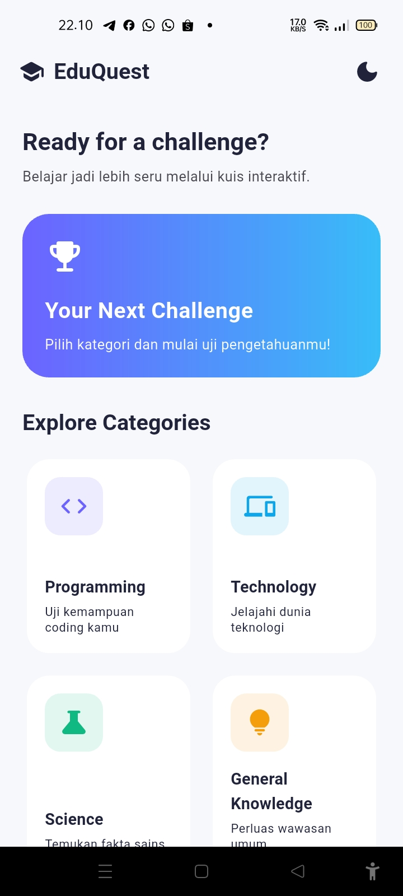
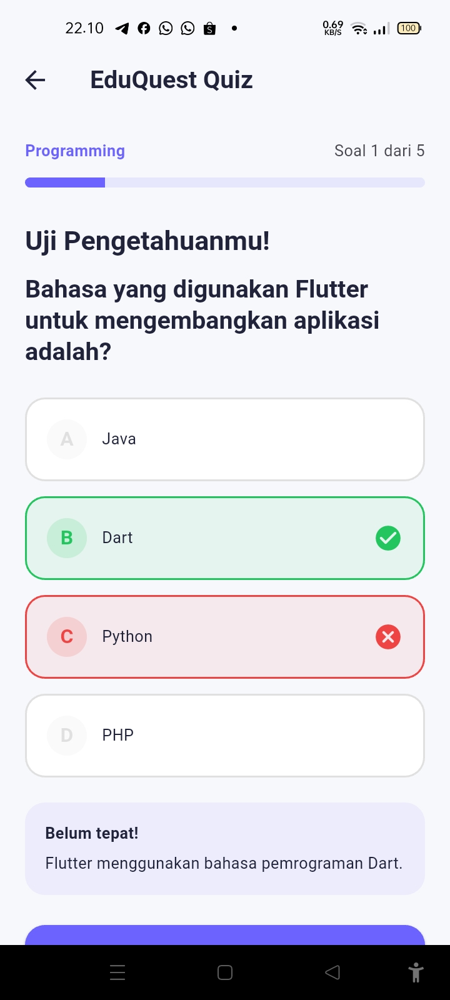
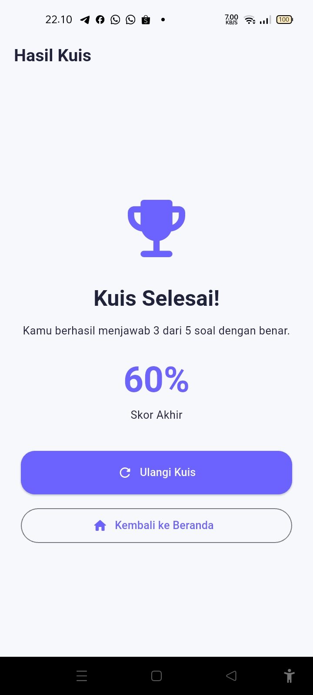
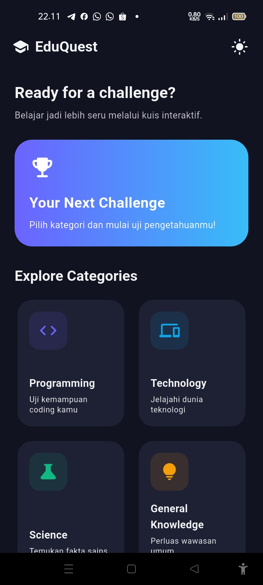

# EduQuest — Aplikasi Kuis Edukasi

## A. Identitas Mahasiswa

- **Nama:** Alfin Mubarkah Tanjung
- **NIM:** 241401013
- **Lab:** Lab 1

## B. Informasi Aplikasi

### 1. Nama Aplikasi
**EduQuest**

### 2. Deskripsi Singkat
EduQuest merupakan aplikasi kuis edukasi berbasis Flutter yang dirancang untuk membantu pengguna menguji pengetahuan melalui pertanyaan interaktif dari beberapa kategori. Aplikasi ini menyediakan pilihan jawaban, pembahasan, hasil kuis, serta riwayat skor agar pengguna dapat melihat perkembangan hasil kuisnya.

### 3. Fitur-Fitur yang Tersedia

- **Kategori Kuis:** Memilih kategori pertanyaan yang tersedia.
- **Kuis Interaktif:** Menjawab pertanyaan pilihan ganda.
- **Navigasi Pertanyaan:** Berpindah ke pertanyaan berikutnya atau sebelumnya.
- **Pembahasan Jawaban:** Melihat penjelasan jawaban.
- **Hasil Kuis:** Menampilkan skor setelah kuis selesai.
- **Dark Mode dan Light Mode:** Mengganti tampilan tema aplikasi.
- **State Management:** Menggunakan Provider untuk mengelola state aplikasi.
- **Responsive UI:** Menyesuaikan tampilan dengan ukuran layar perangkat.

## C. Dokumentasi

### 1. Credit Sumber Aset

- **Font:** Nunito — https://fonts.google.com/specimen/Nunito.
- **Ikon:** Menggunakan Material Icons bawaan Flutter.

Jika tidak menggunakan aset gambar eksternal, tuliskan bahwa gambar eksternal tidak digunakan. Jangan mencantumkan sumber aset yang sebenarnya tidak dipakai.

### 2. Screenshot Setiap Halaman Aplikasi

#### Halaman Home

#### Halaman Kuis

#### Halaman Hasil Kuis

#### Halaman dengan Tema Gelap

### 3. Link Mockup/Prototype Aplikasi

**Link Figma atau Prototype:** - https://www.figma.com/design/n9IBKDwhOwCprQvk0aFmGU/EduQuest-%E2%80%94-Mobile-Quiz-App?node-id=0-1&t=H9X1cvFDTgVCuwOc-1.

### 4. Link Video Presentasi

**Video Presentasi:** -.
